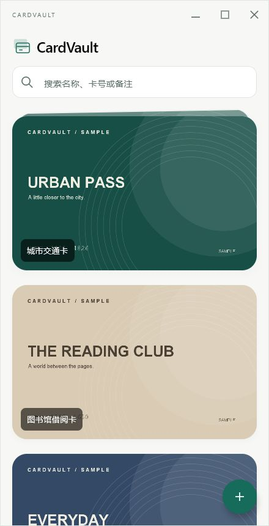
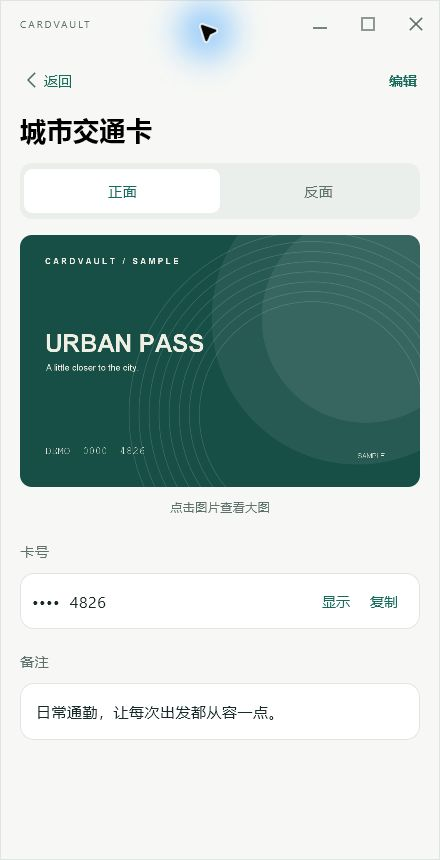
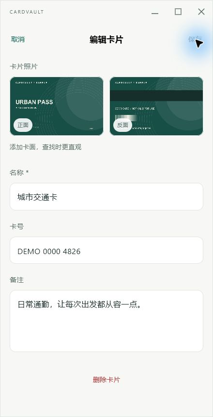

# CardVault · JVM 历史说明

本文保留迁移前的运行与发布说明，命令均从项目根目录执行。当前 Avalonia 入口见 [项目 README](../README.md)。

用 Kotlin Multiplatform + Compose Multiplatform 编写的卡片管理应用，当前运行目标为 Windows / macOS / Linux 桌面（JVM）。界面采用竖屏布局和自绘标题栏。

## 界面预览

以下为 Windows 下 demo 模式的实际截图，使用虚构卡片数据。

| 卡片列表 | 卡片详情 | 编辑卡片 |
| :---: | :---: | :---: |
|  |  |  |

## 下载

| 平台 | 下载 |
| --- | --- |
| Windows x64 | [单文件 EXE](https://github.com/dongfg/CardVault/releases/latest/download/CardVault-windows-x64.exe) |
| macOS Intel | [DMG](https://github.com/dongfg/CardVault/releases/latest/download/CardVault-macos-x64.dmg) |
| macOS Apple Silicon | [DMG](https://github.com/dongfg/CardVault/releases/latest/download/CardVault-macos-arm64.dmg) |

[所有版本](https://github.com/dongfg/CardVault/releases) · [构建记录与产物](https://github.com/dongfg/CardVault/actions/workflows/build-desktop.yml)

下载链接在首次发布 Release 后生效。macOS 产物目前未配置签名与公证。

## 运行

```powershell
.\gradlew.bat :desktopApp:run
```

开发运行时读取项目根目录的 `cardvault.db`。首次使用点击「创建新卡册」；已有数据库但尚未同步到本机时，请等待同步后点击「重新读取」。

## 数据存储

卡片名称、卡号、备注及正反面图片统一存入 SQLite，图片使用 BLOB 保存，不依赖原始照片或其他图片目录。数据库目前未加密。

Windows 分发版读取外层 EXE 同级的 `cardvault.db`；macOS 读取 `.app` 同级的数据库（请先从 DMG 拖出应用），不依赖启动时的工作目录：

```text
OneDrive/CardVault/
├── CardVault.exe      # Windows 单文件程序
├── CardVault.app      # macOS 应用
├── cardvault.db       # 两个平台共用
└── backups/           # 保存前快照，保留最近 5 份
```

同一时刻只在一台设备上使用。切换前关闭应用，等待 OneDrive 上传完成；另一台设备确认数据库已下载、同步完成后再打开。使用 DELETE 日志模式，保存事务完成后关闭连接；不要在写入过程中手动复制数据库。OneDrive 负责文件同步，应用本身不合并同步冲突。

恢复备份时，先关闭应用，保留当前数据库，再将所需 `backups/cardvault-*.db` 复制为应用旁的 `cardvault.db`。可用环境变量 `CARDVAULT_DB_PATH` 指定完整数据库路径。

预览图片列表，可运行独立演示卡册：

```powershell
.\gradlew.bat :desktopApp:run --args="--demo"
```

演示数据库位于 `build/demo-data/cardvault.db`，包含三张明确标注 SAMPLE / DEMO 的虚构卡片，与正常卡册隔离。演示模式也支持添加、编辑和删除，修改会保留。路径环境变量优先于默认路径，预览时请勿指向真实卡册。

## 打包

在项目根目录、对应操作系统上执行：

| 平台 | 命令 | 输出目录 |
| --- | --- | --- |
| Windows | `.\gradlew.bat :desktopApp:packageSingleExe` | `desktopApp/build/distributions/`（`CardVault-<版本>-windows-<架构>-single.exe`） |
| macOS | `bash ./gradlew :desktopApp:packageReleaseDmg` | `desktopApp/build/compose/binaries/main-release/dmg/` |
| Linux | `bash ./gradlew :desktopApp:packageReleaseDeb` | `desktopApp/build/compose/binaries/main-release/deb/` |

以上分发流程均使用 ProGuard 裁剪未用代码，保持多个 JAR，不做混淆；SQLite 仅携带当前操作系统的原生库。日常 `run` 和测试不裁剪。

推送 `v主版本.次版本.补丁号` 标签后，GitHub Actions 自动构建 Windows x64、macOS Intel 和 Apple Silicon，并在全部成功后发布 Release。版本直接读取标签，例如 `v1.0.1` 对应安装包版本 `1.0.1`；产物保留 30 天，已有 Release 不会被覆盖。

```bash
git tag v1.0.1
git push origin v1.0.1
```

本地构建默认使用 `gradle.properties` 中的 `cardvaultVersion`，可通过 `"-PcardvaultVersion=1.0.1"` 指定版本。

## 功能

- 卡面图片优先的列表；名称、卡号、备注搜索。
- 添加、查看、编辑、删除；正反面照片分别导入、替换和移除。
- 卡号默认掩码，支持显示、隐藏和复制。
- 图片大图预览、缩放和拖动。
- 保存失败保留草稿；离开或关闭窗口前检查未保存修改。
- 统一自绘窗口栏：拖动、最小化、最大化／还原、关闭。

## 检查

```powershell
.\gradlew.bat :desktopApp:test :shared:jvmTest
```

验证 ProGuard 裁剪后的存储功能（不生成分发包）：`.\gradlew.bat :desktopApp:testRelease`。

测试覆盖路径定位、数据库创建、图片 BLOB、单库跨目录读取、事务回滚、过期写入保护、备份、搜索和短卡号掩码。

## 结构

- `shared/src/commonMain`：可共享的数据模型、界面与存储接口。
- `desktopApp/src/main`：桌面窗口、文件选择、图片读取、本地存储与演示数据。
- `UI-DESIGN.md`：设计与交互约定。

当前只在 Windows 上进行实际运行验证；macOS 与 Linux 的窗口行为仍需在对应平台验证。

## 开源协议

本项目采用 [MIT License](../LICENSE)，Copyright © 2026 dongfg。
